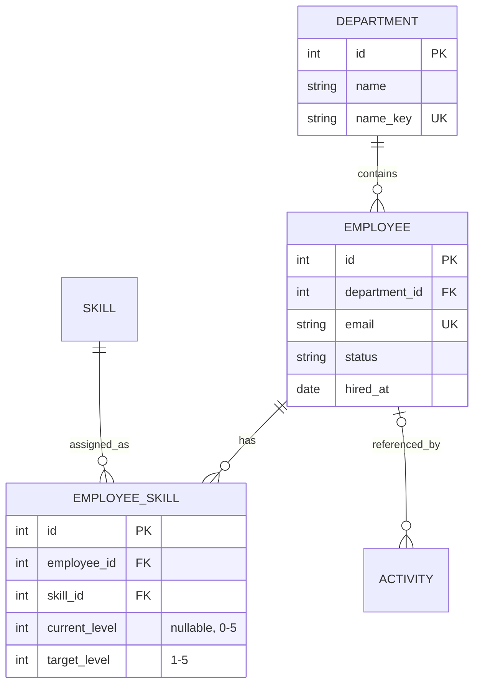

# Архитектура HRM

Это первый локальный этап системы управления персоналом и навыками. Backend — Python/FastAPI, SQLAlchemy 2 и SQLite; frontend — React, TypeScript, Vite и TanStack Query. Python- и npm-зависимости зафиксированы в `uv.lock` и `package-lock.json`.

## Границы ответственности

- `backend/app/main.py`: сборка приложения, HTTP middleware и преобразование доменных ошибок в HTTP-ответы. `security.py`: проверка Origin, ограничение объявленного размера запроса и защитные заголовки; Starlette проверяет Host и фактический размер тела.
- `backend/app/{employees,departments,skills,dashboard}.py`: маршруты, валидация параметров запросов и HTTP-контракты.
- `backend/app/services/`: единое место бизнес-логики всех модулей — сотрудники, подразделения, навыки, сертификаты, задачи, сводка и матрица. `common.py` содержит общие операции транзакций, поиска и журнала событий. `task_rules.py` — правила обучения, валюты и преобразования точных величин; `assessment_rules.py` — состояния оценок и процент достижения цели. Сервисы и правила не зависят от FastAPI/Starlette.
- `backend/app/storage.py`: работа с путями и удалением файлов сертификатов; сервисы не обращаются к файловому хранилищу через другой предметный сервис.
- `backend/app/models.py`: структура хранения и связи. `schemas.py`: отдельные входные/выходные DTO с валидацией Pydantic.
- `backend/app/database.py`: подключение и сессии. Одна сессия на запрос; конфликты записи откатывают транзакцию. Изменение данных и запись события фиксируются вместе.
- `backend/migrations/`: версионируемые миграции Alembic, независимые от актуального определения моделей. Таблицы не создаются автоматически при старте API.
- `frontend/src/pages/`: страницы и организация взаимодействия. `components/`: переиспользуемые элементы и формы; `components/dashboard/`: самостоятельные блоки главной страницы.
- `frontend/src/lib/api.ts`: типизированный HTTP-клиент и обработка ошибок. TanStack Query хранит серверное состояние и инвалидирует данные после изменений; URL хранит фильтры и страницу списка.

Отдельный универсальный repository, DI-контейнер, базовые CRUD-классы и микросервисы здесь не нужны. SQLAlchemy уже предоставляет unit of work. Сервисы работают с конкретными операциями предметной области, а не с искусственной иерархией абстракций.

Бизнес-логика сосредоточена в одном каталоге и разделена по предметным операциям. HTTP-маршруты только принимают DTO, вызывают сервис и оформляют ответ. Pydantic проверяет типы, длины и диапазоны; проверка сочетаний параметров обучения делегируется `services/task_rules.py`. Вычисляемые свойства ORM также делегируют расчёты правилам. Ограничения БД остаются дополнительной защитой целостности и не заменяют сервисы.

Frontend управляет формами, серверным состоянием и отображением. `Assessment.state` и `SkillMetric.coverage` приходят из API; сравнение текущего и целевого уровня и расчёт процентов в UI отсутствуют. `unassigned` остаётся состоянием отображения для отсутствующего назначения. Человекочасы формы запрашиваются у API. При добавлении нового правила изменяйте сервис или модуль правил, затем при необходимости DTO и отображение. Тест `test_service_boundaries.py` запрещает импорт HTTP-фреймворков из сервисов.

## Модель данных

На пару сотрудник–навык приходится одна запись. PUT оценки обновляет существующую запись или создаёт новую. `null` — оценка ещё не проводилась, `0` — нет опыта. Отсутствие записи — навык не назначен. Ограничения диапазонов и уникальности действуют и на уровне БД.

Подразделение с сотрудниками и назначенный навык удалить нельзя. При удалении сотрудника его оценки удаляются каскадно; ссылка на него в событиях становится `null`, текст события сохраняется. Вместо удаления сотрудника можно выбрать статус «Неактивен».

Названия подразделений/навыков и email сравниваются без учёта регистра. Для поиска кириллицей используется нормализованный `casefold` текст; `%` и `_` в поисковой строке трактуются буквально. Добавление полнотекстового поиска имеет смысл при фактическом росте объёма данных.

## Определения показателей

- Число сотрудников и распределение по подразделениям включают все статусы, включая неактивных. «Работают» — только `active`; испытательный срок и отпуск учитываются отдельно.
- Показатели навыков также включают все статусы. Матрица позволяет ограничить отображение статусом и подразделением.
- Достигли цели, % = число назначений с текущим уровнем не ниже целевого / все назначения × 100, округление до целого. Неоценённые назначения входят в знаменатель.
- Зоны развития = оценённые назначения ниже цели. Оценки, которые ещё не проведены, учитываются отдельно.
- Средний уровень = среднее по оценённым назначениям; `null` не учитывается, `0` учитывается. Это описательная величина на порядковой шкале, а не показатель производительности человека.
- Показатели рассчитываются backend; frontend не поддерживает независимые счётчики.

## SQLite и дальнейшее развитие

SQLite подходит для локального приложения и небольшой нагрузки на запись. Внешние ключи включены для каждого подключения, `busy_timeout` составляет 5 секунд. Синхронные обработчики FastAPI выполняются в пуле потоков; асинхронный интерфейс над синхронным SQLite не добавлен.

Для перехода на PostgreSQL потребуется драйвер, новый `HRM_DATABASE_URL`, применение миграций, перенос данных и интеграционные проверки на PostgreSQL. На PostgreSQL текущая реализация ещё не проверена. Само изменение URL не переносит данные. При высокой нагрузке понадобятся соответствующие индексы, ограничения выборок каталога/сводки и потоковый экспорт: сейчас CSV собирается в памяти.

Схема оценки пока хранит последнее состояние навыка. Журнал событий — история действий без идентификации пользователя, не полноценный аудит. Для периодических аттестаций нужно добавить отдельные сущности с датой, оценщиком и неизменяемым результатом; нельзя использовать журнал событий как таблицу оценок.

Авторизация, четыре роли и журнал действий с автором реализованы; устройство описано ниже. История аттестаций, требования к навыкам по должностям и планы развития остаются самостоятельными направлениями развития. Прикладной API требует входа; скрипт запуска привязывает серверы к `127.0.0.1`.

Навигация сейчас вертикальная и фиксированная; её список сосредоточен в `Layout.tsx`. На мобильном экране меню открывается отдельной панелью. Для будущего сворачивания desktop-меню можно добавить состояние оболочки, сохранив маршруты и страницы.

При добавлении функций сначала уточняйте предметные правила, затем расширяйте сервис и API-контракт. Если отсутствует нужный файл/модель/API, это требуется явно указать, а не предполагать существование.

## Kanban-доска задач и обучения

Контракты и хранение задач расположены в `backend/app/tasks/`: модели, схемы, HTTP-маршруты и отдельная команда демонстрационных данных. Бизнес-операции находятся в `backend/app/services/tasks.py`, правила обучения и расчёт трудоёмкости — в `services/task_rules.py`. UI модуля — `frontend/src/features/tasks/`; страница `TasksPage.tsx` соединяет фильтры, сводку, колонки и формы. Миграция `0003` создаёт таблицы задач и не изменяет существующие кадровые записи.

Задача имеет название, описание, статус (`todo`, `in_progress`, `done`), необязательный срок и стоимость. Для обучения дополнительно задаются источник (`internal` / `external`), формат (`individual` / `group`), число участников и необязательная длительность. Обычная задача оставляет параметры обучения пустыми. Индивидуальное обучение предполагает одного участника, групповое — минимум двух. Число участников вводится вручную: это не сумма сотрудников выбранных подразделений, поскольку обучение может охватывать только часть команды или внешних участников.

Задачи связаны с подразделениями отношением многие-ко-многим через `task_departments`. Связь не дублирует записи задач. Фильтрация использует EXISTS, поэтому задача с несколькими подразделениями не учитывается в суммах несколько раз. Нельзя удалить подразделение, указанное в задачах; при удалении задачи удаляются её связи, а сами подразделения сохраняются.

Длительность хранится в сотых долях часа, стоимость — целым числом минимальных денежных единиц (`BigInteger`). В API точные десятичные величины передаются строками; ввод проверяет Decimal/Pydantic. Человекочасы = длительность × число участников; текущий алгоритм один, его используют чтение карточки и endpoint предварительного расчёта. Неизвестная длительность даёт `null`, а не ноль. Расчёт предполагает одинаковую длительность для всех участников; для различной посещаемости в будущем нужна отдельная таблица присутствия с длительностью на участника.

Сводка учитывает выбранные фильтры и все три статуса. Это общая расчётная трудоёмкость, включая запланированные обучения; чтобы учитывать фактически затраченное время завершённого обучения, пользователь вводит фактические значения. Стоимость — за всё обучение/задачу, не за человека. Нулевая стоимость означает бесплатно; отсутствие значения означает неизвестную стоимость. Разные валюты суммируются независимо, конвертация курсов не выполняется.

Колонки используют отдельные пагинированные запросы (20 карточек за порцию), «Показать ещё» догружает страницы. Сводка не ограничивается загруженными карточками. Порядок — последняя изменённая задача сверху, затем ID; перемещённая карточка видна и в заполненной колонке. Поиск регистронезависимый, включая кириллицу; фильтры хранятся в URL.

При перемещении UI сразу отображает карточку в новой колонке, блокирует повторный перенос той же карточки и сохраняет статус. После ответа данные обновляются. При отказе API карточка возвращается на актуальное место, пользователь видит ошибку. HTML drag-and-drop используется на desktop, список статусов в карточке доступен с клавиатуры и на телефоне.

Полные изменения, переносы и удаление используют `version`. Клиент отправляет прочитанную версию; при конфликте API возвращает 409. SQLAlchemy дополнительно проверяет версию в UPDATE/DELETE, защищая от двух запросов, которые одновременно прочитали одну версию. Клиент должен заново открыть актуальную карточку и повторить изменение. Изменение данных и событие сохраняются одной транзакцией. Статус Done сам по себе не изменяет оценки навыков сотрудника: такого предметного правила пока нет.

API: `GET/POST /api/tasks`, `GET/PUT/DELETE /api/tasks/{id}`, `PUT /api/tasks/{id}/status`, `GET /api/tasks/summary`, `POST /api/tasks/estimate`. Для DELETE требуется query-параметр `version`; полное обновление и смена статуса передают его в JSON. Сервисы не зависят от FastAPI, HTTP-клиент задач переиспользует общий механизм ошибок.

Официальные источники для реализации: [SQLAlchemy — version counters](https://docs.sqlalchemy.org/en/20/orm/versioning.html), [MDN — HTML Drag and Drop](https://developer.mozilla.org/en-US/docs/Web/API/HTML_Drag_and_Drop_API).
## Авторизация и область доступа (23 октября 2026)

`app/auth.py` отвечает за серверные сеансы, проверку входа, HTTP-проверки доступа и управление аккаунтами. `app/permissions.py` определяет SQL-фильтры сотрудников, подразделений и задач. Обработчики подключены с обязательной зависимостью авторизации; запросы коллекций используют область видимости до подсчёта, агрегации и пагинации. Прикладные сервисы сохраняют независимость от FastAPI. Административные API аккаунтов имеют отдельную зависимость роли администратора.

Аккаунт ссылается на сотрудника (один к одному); администратор может существовать без кадровой карточки. Отдел руководителя берётся из его сотрудника и проверяется заново на каждом запросе. Роли: `admin`, `power_user`, `manager`, `employee`. Обычный сотрудник может редактировать личные данные и резюме, навыки и сертификаты, но не менять кадровые поля/отдел. Руководитель может редактировать весь свой отдел, включая других руководителей. Общие справочники, создание/удаление сотрудников и межотдельные переводы доступны глобальным ролям. Управление аккаунтами — только `admin`.

Задача содержит необязательный `assignee_id`. Обычный сотрудник видит только задачи с собственным ID; руководитель — задачи сотрудников своего отдела и неназначенные задачи, относящиеся только к его отделу. Межотдельные задачи остаются под глобальным управлением. Миграция `0005` сохраняет старые задачи без исполнителя, добавляет аккаунты/сеансы, поля резюме и автора событий. Сеансы хранят хеш случайного токена и время истечения; браузер получает только HttpOnly cookie.
